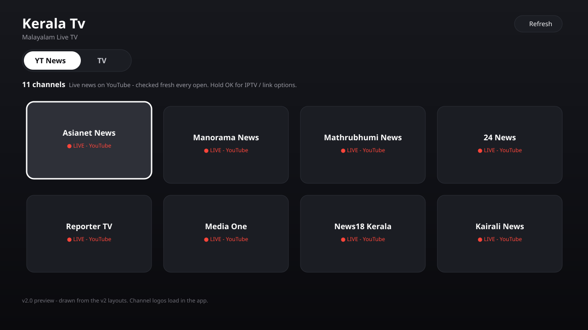
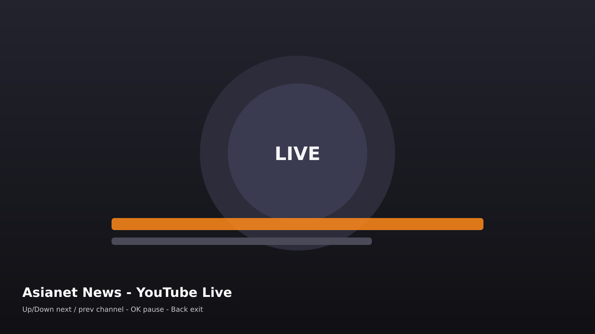

# Kerala Tv

A minimal Android TV app for watching live Malayalam TV, built for the remote first. Channels come from the free [iptv-org](https://github.com/iptv-org/iptv) playlists and refresh inside the app, so the lists stay current without an app update.

**v2.5 (2026-10-23): Malayalam only, two sections, Apple TV-style UI.** Everything that is not Malayalam was removed (v2.0); v2.5 adds the video-only YouTube embed, the quality toggle + lip-sync watchdog, and the new logo art. This is the current stable build.

## Preview





_Interface illustrations drawn from the app's actual layouts and channel data._

## Features

- **YT News (home page)** — 11 Malayalam news channels whose YouTube Live is the primary source: Asianet News, Manorama News, Mathrubhumi News, 24 News, Reporter TV, Media One, News18 Kerala, Kairali News, Janam TV, Big TV 24x7 and Jaihind TV. Handles verified 2026-10-23 in `yt-news-channels.md`.
- **Self-healing YouTube links** — the app stores only each channel's permanent `@handle/live` page, never a one-off video ID. On every open it resolves each channel's *current* live video ID (tiles show a red LIVE badge), on every tap it resolves the HLS stream fresh and validates it, and if a stream dies mid-play the player re-resolves and resumes. If YouTube is offline for a channel, the app falls back to that channel's IPTV stream. Hold OK on a news tile to play the TV stream, edit the channel link (any pasted channel link is normalized to its `/live` page), or reset it.
- **TV** — Malayalam IPTV channels only (~47 after dedupe), allowlist-filtered from the iptv-org India + Malayalam playlists: Asianet, Surya, Mazhavil Manorama, Flowers, Kairali, Amrita and the rest that iptv-org actually carries, all the news channels above, plus Raj News Malayalam and Real News Kerala (IPTV-only — no YouTube live found). No HD-only filter any more, so SD-only Malayalam channels are no longer dropped; the best-quality variant wins when a channel appears twice.
- **Apple TV-style UI** — dark gradient, one segmented pill for the two sections, large rounded cards, and a white focus ring + 1.10x scale on the focused card.
- **New player UI** — gradient bottom panel with channel logo, LIVE badge, section + position ("1 of 11"), channel name and remote hints, loading label, and auto-fade.
- **Video-only YouTube playback (v2.5)** — the in-app YouTube player runs with its controls fully hidden: no overlay chrome and no seek bar (a live's seek bar drops you into the rewind window - wrong for news). Failed embed attempts happen behind an opaque loading cover, so YouTube error pages are never shown.
- **Quality + lip-sync controls (v2.4/v2.3)** — YouTube playback defaults to 1080p; UP arrow in the YouTube player toggles 1080p/720p (remembered). A watchdog compares the video clock with wall time and jumps back to the live edge if the picture drifts behind the sound; RIGHT arrow resyncs manually.
- **New logo (v2.5)** — the banner/icon are generated by `assets-img/make_img.py`, which measures and auto-fits all text (the previous banner's wordmark ran off the edge of the image).
- **Streams with special headers just work** — per-stream User-Agent / Referer hints from the playlist (EXTVLCOPT) are passed to the player.
- **Fast after first launch** — playlists are cached on the TV for a week; the Refresh button re-fetches them any time.
- Registers as a proper TV app (leanback launcher + banner) and runs fine alongside replacement launchers such as CleanYourTV.

Note that iptv-org streams are free public links: availability varies and some are region-locked. That is a property of the source, not the app.

## Remote controls

| Key | Action |
| --- | --- |
| D-pad | Move between the YT News / TV pill, Refresh and channels (focused card expands) |
| OK | Open channel / pause in player / confirm |
| Hold OK | Options for a YT News tile (YouTube live, TV stream, edit/reset link) |
| Up / Down in player | Next / previous channel |
| Left / Right in player | Show the player info panel |
| Up in YouTube player | Toggle quality 1080p / 720p |
| Right in YouTube player | Resync to the live edge (lip-sync fix) |
| Back | Exit player, back to grid |

## Build

No Gradle. The APK is assembled with the Android SDK build-tools directly (aapt2, ECJ, d8, zipalign, apksigner), the same manual pipeline used for the release builds.

Requirements:

- JDK 17 (javac not needed; ECJ does the compiling)
- Android SDK platform 34 + build-tools 34.0.0
- Python 3 with Pillow (only for regenerating the banner/icon)

```bash
python3 assets-img/make_img.py   # writes res/drawable/banner.png + mipmap icon
bash build.sh                    # produces build/KeralaTv-vX.Y.apk
```

The logo script uses the Montserrat fonts in `assets-img/fonts/` when present and falls back to DejaVu Sans Bold otherwise (the font files are binary and are not synced to this repo; the generated PNGs are also not in the repo - they are build artifacts regenerated by the script).

`build.sh` expects the SDK at `~/android-sdk` and a signing keystore at `~/workspace/instacount/build-tmp/debug.keystore`; adjust the paths at the top of the script for your machine. The build script regenerates the images automatically if they are missing.

## Install

Sideload the APK over ADB:

```bash
adb connect <tv-ip>:5555
adb install KeralaTv-v2.5.apk
```

or copy it to a USB drive and open it from the TV's file app.

## How the YouTube playback works

For a news tile with a YouTube link, the app first tries to resolve the channel's current live stream (page scrape, then YouTube's player API as several client types) and play it in the native player. If that is refused, it plays YouTube's official embedded player inside the app, sending the Referer/origin the embed now requires. Only channels that also block embedding fall back to the YouTube (or SmartTube) app, and the app offers the IPTV stream in that case.

## Credits

Channel data: [iptv-org](https://iptv-org.github.io/) — a community-maintained collection of publicly available streams. This app is a player for those playlists; it hosts no streams itself.
